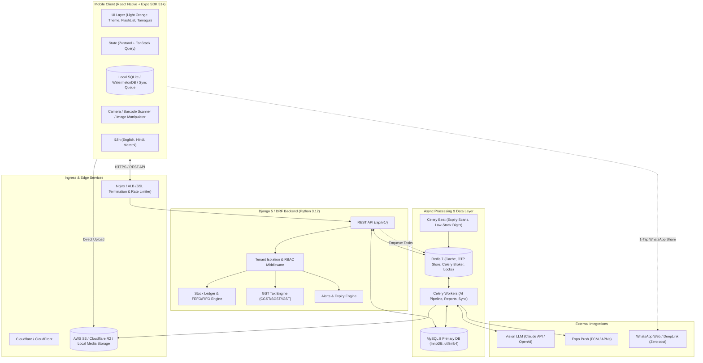
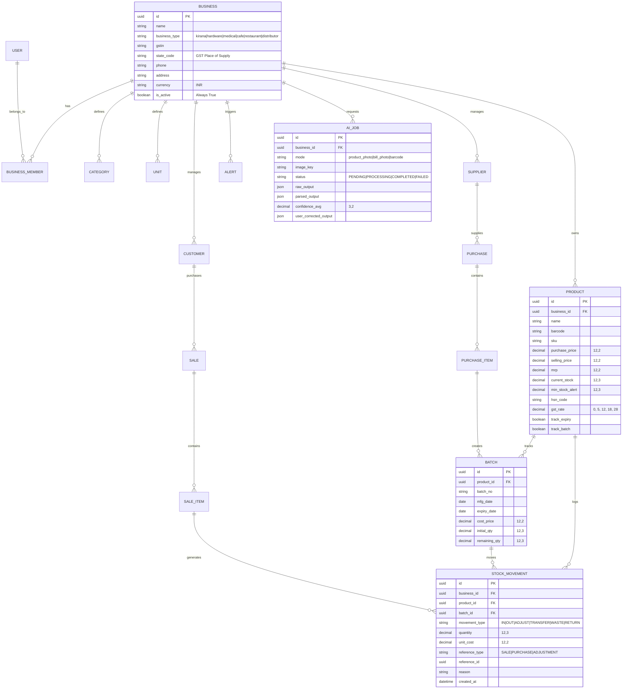

# StockWise — System Architecture Document (100% Free / Community Edition)
**Product:** Smart Inventory & Stock Alert System (India, Mobile-First, AI-Powered)  
**License:** Free & Open for all Indian Small & Medium Businesses  
**Version:** 2.0.0 (No Paywall / No Subscriptions)

---

## 1. High-Level Architecture Overview

StockWise is an **unrestricted, 100% free, offline-first mobile SaaS** tailored specifically for Indian retail and wholesale businesses (Kirana, Medical Stores, Hardware shops, Cafes, and Distributors). All features—unlimited products, sales, GST billing, multi-user access, low-stock/expiry alerts, and AI photo extractions—are permanently enabled without trials, paywalls, or payment gateways.

---

## 2. Core Module Breakdown (Free Edition)

| Module | Location | Purpose & Key Responsibilities |
| :--- | :--- | :--- |
| **`accounts`** | `backend/apps/accounts` | Multi-tenant auth, phone OTP verification via Redis, JWT lifecycle (SimpleJWT), business registration, membership & RBAC (Owner, Manager, Staff). Every business is permanently active. |
| **`products`** | `backend/apps/products` | Master catalog, categories, units, variants, barcode lookups, GST/HSN mappings, and shared **Global Product Master**. |
| **`inventory`** | `backend/apps/inventory` | Append-only `StockMovement` ledger, transactional stock balance calculation, `Batch` tracking (mfg, expiry, cost), **FEFO auto-picking**, adjustments, stock-in/out. |
| **`billing`** | `backend/apps/billing` | GST POS sale generation, tax engine (inter-state IGST vs intra-state CGST/SGST), custom invoice numbering, customer udhaar (credit) ledger, PDF generation (`expo-print`/ReportLab). |
| **`suppliers`** | `backend/apps/suppliers` | Supplier profiles, purchase bills, payment ledger (cash/credit/partial), item price tracking, 1-tap "Reorder via WhatsApp" (prefilled template). |
| **`alerts`** | `backend/apps/alerts` | Periodic low-stock evaluator, expiry tiers (90/60/30/15/7 days), dead stock detector, in-app notification inbox, and Expo Push notification dispatcher. |
| **`ai_ingest`** | `backend/apps/ai_ingest` | Image preprocessing, vision LLM extraction (`product_photo`, `bill_photo`, `barcode`), confidence score calculation (< 0.8 flag), feedback loop storage into Global Product Master. |
| **`sync`** | `backend/apps/sync` | Offline-first delta synchronization (`/sync/pull`, `/sync/push`), conflict resolution (server timestamp + append-only ledger), idempotency key validation. |
| **`reports`** | `backend/apps/reports` | Unlimited P&L calculation, COGS calculation, GSTR-1/GSTR-3B summaries, stock valuation (Cost vs MRP), ABC inventory analysis, Excel/PDF exports. |

---

## 3. Database Entity Relationship (ER) Diagram

---

## 4. AI Ingestion & Shared Global Product Master

Because the app is free, optimizing AI operating cost is critical:
1. **Deduplication:** Hash of image (`SHA-256`) and Barcode lookup check the **Global Product Master** first.
2. If another shop in India has scanned this barcode (e.g. Parle-G 800g, Dolo 650mg, Asian Paints 1L), extraction returns instantly from the database at **0 API cost**.
3. Fresh extractions run via Claude / Vision LLM, parse strictly to Pydantic schemas, and feed back into the global master upon user confirmation.

---

## 5. Offline-First Sync & Conflict Resolution

- **Stock Movements:** Append-only ledger; sales recorded while offline sync automatically when back online.
- **Transactional Atomic Lock:** Backend executes `select_for_update()` on product stock movements so multi-device kirana counters never corrupt inventory totals.
- **Zero Lockout:** No subscription validation checks; offline records are always accepted.
